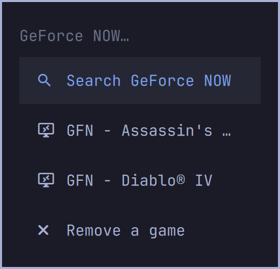
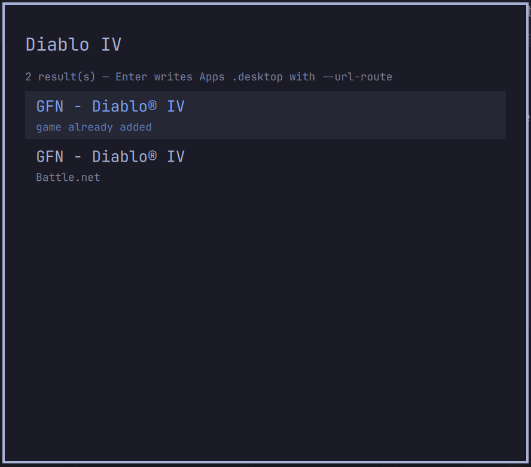
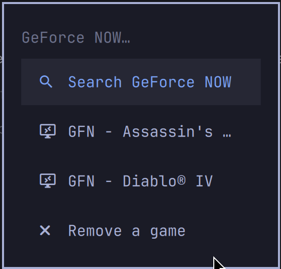

# GeForce NOW Menu (`gfn-omarchy`)

Installable **Omarchy (Quattro)** plugin that aims to make GeForce NOW titles feel native in Omarchy: search from the menu, pick a game, land an Apps launcher, launch without hunting inside the GFN client.

> **Identity**
>
> | Field | Value | Status |
> |-------|-------|--------|
> | Manifest `id` | `matt-dance.gfn-omarchy` | Locked |
> | Display `name` | **GeForce NOW Menu** | Locked |
> | Repo-oriented name | `gfn-omarchy` | Locked |

The plugin id is `matt-dance.gfn-omarchy`. Omarchy names third-party plugins `author.short-name` (the same shape as `njpatel.omabot`). The install folder is `~/.config/omarchy/plugins/matt-dance.gfn-omarchy` and must match that id. Display name stays **GeForce NOW Menu**.

## Screenshots

Setup → Plugins on this Omarchy build lists a name and an id. It does not draw images. The community listing at [plugins.omarchy.org](https://plugins.omarchy.org) uses one file at the repo root, `preview.png` (png, jpg, jpeg, webp, or avif). That file is the Gaming → GeForce NOW menu: search, the installed games, and remove.







The box art is the desktop `Icon`. The Apps menu draws that image. Gaming → GeForce NOW rows only get a font glyph, so they cannot show the box art. The store is the menu row's `description` and the desktop `Comment`. While you browse, this Omarchy menu draws the title only. It draws a second line only while the menu filter is active, and that line is the menu path, not the store. The store subtitle shows on the search result, as in the search shot.

Search, add, multi-remove, and direct launch work. Search fetches and caches the public GraphQL apps list (`games.geforce.com/graphql`, US/`en_US`, TTL ~6h) and filters locally by title. This repo does not invent authenticated GFN search or library APIs. A game that is already on the menu still appears in search, with the subtitle `game already added`, and Enter does not add it again. Menu and desktop names are `GFN - <Game Name>`, with the store as the subtitle. Launch goes through `scripts/gfn-play.sh`. Offline or cache failure falls back to Diablo IV.

## Why `overlay` + `service`?

From Omarchy’s Quattro plugin model:

| Kind | Role in this plugin |
|------|---------------------|
| **`overlay`** | Fullscreen search UI (same pattern as built-in emoji / clipboard overlays). Summoned from a menu `action:` via `omarchy-shell shell summon`. |
| **`service`** | Headless singleton for add-to-Apps / Flatpak `--url-route` launch so the overlay stays UI-focused and helpers stay mounted (`keepLoaded: true`). |

`omarchy plugin add` only clones, validates, and toggles enablement. It does not inject menu rows or write `.desktop` files. Those are the companion steps below. Launch details and the machine constraints are in [`HANDOFF.md`](HANDOFF.md). The original design is in [`PLAN.md`](PLAN.md).

## First steps

Do these before adding the plugin. This plugin does not install GeForce NOW or sign you in.

1. **Install GeForce NOW.** On Omarchy: Install › Gaming › NVIDIA GeForce NOW.
2. **Log in.** Open GeForce NOW and sign in to the account that owns the games. A launch cannot start a game until that account is signed in.

You also need Omarchy with Quattro shell plugins (`omarchy-shell`). `update-desktop-database` is optional; it refreshes Apps after a launcher is written.

## Install

After GeForce NOW is installed and you are logged in:

```bash
omarchy plugin add https://github.com/matt-dance/omarchy-gfn-menu-plugin.git --enable
```

Review-first (lands disabled):

```bash
omarchy plugin add https://github.com/matt-dance/omarchy-gfn-menu-plugin.git
# inspect ~/.config/omarchy/plugins/matt-dance.gfn-omarchy/
omarchy plugin enable matt-dance.gfn-omarchy
```

Manual / local checkout:

```bash
# from a clone of this repo:
cp -a . ~/.config/omarchy/plugins/matt-dance.gfn-omarchy
omarchy-shell shell rescanPlugins
omarchy plugin enable matt-dance.gfn-omarchy
```

Plugins run **unsandboxed** inside `omarchy-shell` as your user. Review code before enabling.

## Menu extension (required companion step)

`plugin add` **does not** merge menu JSONC. After `omarchy plugin add … --enable`, install the sample Games rows with the safe helper:

```bash
# From a clone, or from ~/.config/omarchy/plugins/matt-dance.gfn-omarchy/
bash scripts/install-menu-extension.sh
# Preview only:
bash scripts/install-menu-extension.sh --dry-run
omarchy menu refresh
```

[`scripts/install-menu-extension.sh`](scripts/install-menu-extension.sh) merges [`extensions/omarchy-menu.jsonc`](extensions/omarchy-menu.jsonc) into `~/.config/omarchy/extensions/omarchy-menu.jsonc` inside a managed `BEGIN`/`END matt-dance.gfn-omarchy` block. It is idempotent (updates the marked block, or skips if the keys are already present), never wipes other user rows, and writes a `*.bak.<timestamp>` backup before changing the file.

Manual merge still works: copy the sample keys by hand, keep the file valid JSONC (broken user JSONC silently drops **all** user extension rows), then `omarchy menu refresh`.

The sample action summons the overlay:

```bash
omarchy-shell shell summon matt-dance.gfn-omarchy '{}'
```

## Catalog search (v1)

Public GraphQL catalog → disk cache → local title filter (no authenticated `searchQuery`).

| Path | Purpose |
|------|---------|
| [`scripts/gfn-catalog-search.py`](scripts/gfn-catalog-search.py) | Paginate `https://games.geforce.com/graphql`, cache under `$XDG_CACHE_HOME/matt-dance.gfn-omarchy/` (TTL ~6h), filter by title |
| `Service.qml` → `search()` | Runs the helper via Quickshell `Process`; Overlay watches `lastResults` |
| Offline fallback | Diablo IV row if network and cache both fail |

```bash
# From a checkout (or the installed plugin dir):
python3 scripts/gfn-catalog-search.py "Diablo IV"
# → JSON array: [{id, cmsId, title, shortName}, ...]
# Cache file: ${XDG_CACHE_HOME:-$HOME/.cache}/matt-dance.gfn-omarchy/apps-US-en_US.json
# Force refetch:  python3 scripts/gfn-catalog-search.py "Diablo IV" --refresh
```

`cmsId` is a **variant** id (Steam preferred when present). Top-level catalog ids like `101069911` are not launch-safe. `shortName` may be `""` — empty is valid; do not invent `game_gfn_pc`.

## Apps / `.desktop` launchers (RetroArch pattern)

Omarchy has no first-party per-game library provider. “Native” titles typically appear via the built-in **`apps`** provider (desktop entries), same idea as Install › Gaming › RetroArch Game Launcher.

This plugin ships:

| Path | Purpose |
|------|---------|
| [`scripts/write-desktop-entry.sh`](scripts/write-desktop-entry.sh) | Writes `~/.local/share/applications/gfn-<cmsId>.desktop`. `Name` is `GFN - <Game Name>`. `Comment` is the store. `Exec` calls `gfn-play.sh`. |
| [`desktop/gfn-example.desktop.example`](desktop/gfn-example.desktop.example) | Diablo IV example entry (not installed automatically) |

Launch pattern (proven `gfn-play-diablo-iv` / HANDOFF):

```bash
nv_host="$(flatpak --gl-drivers 2>/dev/null | grep -Eo '^nvidia-[0-9-]+' | head -n 1)"
flatpak run --user \
  --command=/app/cef/GeForceNOW --cwd=/app/cef \
  ${nv_host:+--env=NV_HOST_DRIVER_VERSION="$nv_host"} \
  ${nv_host:+--env=NV_FLATPAK_DRIVER_VERSION="$nv_host"} \
  com.nvidia.geforcenow \
  --url-route='#?cmsId=<VARIANT_CMS_ID>&launchSource=External&shortName=&parentGameId=<UUID>'
```

### Diablo IV example (proven Steam variant)

| Field | Value |
|-------|--------|
| Title | Diablo IV |
| `cmsId` (Steam) | `102670811` |
| `cmsId` (Battle.net) | `102348311` |
| `parentGameId` / `id` | `d32c9410-62cb-45cf-9c53-740bb92d4a2d` |
| `shortName` | empty |

```bash
bash scripts/write-desktop-entry.sh \
  --cms-id 102670811 \
  --parent-game-id d32c9410-62cb-45cf-9c53-740bb92d4a2d \
  --title "Diablo IV" \
  --short-name "" \
  --force
```

Resulting `Exec=` (NV version from `flatpak --gl-drivers`):

```text
flatpak run --user --command=/app/cef/GeForceNOW --cwd=/app/cef --env=NV_HOST_DRIVER_VERSION=nvidia-… --env=NV_FLATPAK_DRIVER_VERSION=nvidia-… com.nvidia.geforcenow "--url-route=#?cmsId=102670811&launchSource=External&shortName=&parentGameId=d32c9410-62cb-45cf-9c53-740bb92d4a2d"
```

Desktop keys `X-GFN-CmsId`, `X-GFN-ParentGameId`, and `X-GFN-ShortName` carry the same ids for tooling.

## Validate

On an Omarchy host:

```bash
PLUGIN_DIR="$HOME/.config/omarchy/plugins/matt-dance.gfn-omarchy"
omarchy plugin validate "$PLUGIN_DIR"
# optional, if qmllint + OMARCHY_PATH are available:
qmllint -I "$OMARCHY_PATH/shell" \
  "$PLUGIN_DIR/Overlay.qml" "$PLUGIN_DIR/Service.qml"
```

Rules worth knowing: namespaced non-`omarchy.*` id, every kind has an entry point file, **no symlinks** in the plugin tree.

## What works vs next

| Capability | Status |
|------------|--------|
| Root `manifest.json` (`schemaVersion` 1, `overlay` + `service`, id `matt-dance.gfn-omarchy`) | Works |
| Overlay search and service (`Overlay.qml`, `Service.qml`) | Works. Enter adds the selected row. An already-added row notifies and does not write a second launcher. |
| Gaming menu extension | Works as a copy/merge source. `plugin add` does not apply it. |
| Menu install helper | Works — `scripts/install-menu-extension.sh` (managed `BEGIN`/`END matt-dance.gfn-omarchy` block, backup, dry-run) |
| Added-game menu rows | Works — `scripts/sync-menu-games.sh` rewrites the `gfn-games` block. Label `GFN - <Game Name>`, description is the store. |
| Remove | Works — `scripts/gfn-remove.sh` multi-selects, confirms once, and removes every selected game |
| Desktop entries | Works — `gfn-<cmsId>.desktop`, `X-GFN-*` keys, `X-Omarchy-Plugin=matt-dance.gfn-omarchy` |
| Direct launch | Works — `scripts/gfn-play.sh` uses the CEF `--url-route` path. It refuses when a GeForce NOW window is open, clears a leftover process that has no window, and restarts WirePlumber once if audio permissions block the first frame. |
| Diablo IV launch ids | Proven Steam `cmsId` `102670811` (variant; not top-level `101069911`) |
| Catalog search | Works — `scripts/gfn-catalog-search.py` (GraphQL cache + local filter). Diablo IV is the offline fallback. |
| Auto-merge menu on `plugin add` | Not supported by Omarchy. Use the install helper, or merge by hand. |

## Changing the plugin id later

The id is `matt-dance.gfn-omarchy`. Display `name` stays **GeForce NOW Menu**. A later rename has to touch every copy of the id:

1. Change `id` in [`manifest.json`](manifest.json). Leave `name` as `GeForce NOW Menu`.
2. Update summon strings in `Overlay.qml`, `Service.qml` fallbacks, and `extensions/omarchy-menu.jsonc`.
3. Update `X-Omarchy-Plugin`, cache and state directories, and the `BEGIN`/`END` marker in the scripts.
4. On an install that already uses this id: `omarchy plugin remove matt-dance.gfn-omarchy`, then add again under the new id. The folder name must match.
5. Re-merge the menu action so it summons the new id. Move `~/.local/share/matt-dance.gfn-omarchy/` if added games should carry over.

## Remove

```bash
omarchy plugin remove matt-dance.gfn-omarchy
```

Also remove any Games rows (or the `BEGIN`/`END matt-dance.gfn-omarchy` managed block) from `~/.config/omarchy/extensions/omarchy-menu.jsonc`, and any `~/.local/share/applications/gfn-*.desktop` files you no longer want.

## Layout

```text
.
├── manifest.json
├── preview.png              # marketplace card: Gaming menu with search, games, and remove
├── Overlay.qml              # overlay entry point (search UI)
├── Service.qml              # service entry point (add / --url-route launch)
├── GfnModel.js              # search/launch/writer helpers + Diablo IV fallback
├── extensions/
│   └── omarchy-menu.jsonc   # sample Games-adjacent menu rows
├── scripts/
│   ├── gfn-catalog-search.py       # GraphQL fetch/cache + title filter
│   ├── gfn-play.sh                 # CEF launch, busy window, WirePlumber recovery
│   ├── gfn-remove.sh               # multi-select remove
│   ├── sync-menu-games.sh          # rewrite the gfn-games menu block
│   ├── install-menu-extension.sh   # merge the Gaming → GeForce NOW rows
│   └── write-desktop-entry.sh
├── desktop/
│   └── gfn-example.desktop.example   # Diablo IV example
├── docs/screenshots/
│   ├── searching.png          # search overlay
│   └── added-game.png         # Apps menu row with the desktop box art
├── HANDOFF.md               # launch facts and machine constraints
├── PLAN.md                  # original design
├── LICENSE                  # MIT
└── README.md
```

## License

MIT — see [LICENSE](LICENSE).
